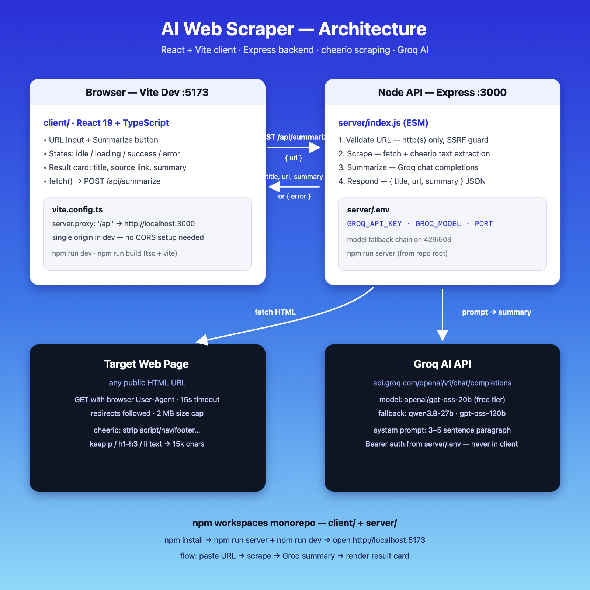

# 🔍 AI Web Scraper

**Paste any webpage URL → get an instant AI summary.**

A full-stack app: a React frontend collects the URL, an Express backend scrapes the page's text, and the free-tier **Groq** API turns it into a short summary.



---

## ✨ Features

| Feature | Detail |
|---|---|
| 🔗 URL input + Summarize button | Validates the URL before sending |
| 🌐 Server-side scraping | `fetch` + `cheerio` extracts headings/paragraphs/list text, strips nav/footers/scripts |
| 🤖 AI summary | Groq (`gpt-oss-20b`, free tier) writes a 3–5 sentence paragraph |
| ⏳ Loading state | Spinner + disabled button while processing |
| ❌ Friendly errors | Bad URL, unreachable page, bot-blocked site, missing API key — each gets a clear message |
| 🔒 Safe | Private/localhost URLs are rejected (SSRF guard); API key never reaches the browser |

---

##  Project Structure

```
├── client/              React 19 + TypeScript + Vite (frontend)
│   ├── src/
│   │   ├── App.tsx      URL form, loading/success/error states
│   │   ├── App.css      UI styles
│   │   └── index.css    theme (indigo → sky gradient)
│   └── vite.config.ts   dev proxy: /api → localhost:3000
│
├── server/              Node + Express (backend)
│   ├── index.js         POST /api/summarize — validate → scrape → Groq → JSON
│   ├── dist/            production build of the client (served by Express)
│   └── .env             ← YOUR GROQ API KEY GOES HERE
│
├── docs/architecture.png
└── package.json         npm workspaces (client + server)
```

---

## 🚀 Run It Locally

### 1. Prerequisites

- **Node.js 18+** (uses built-in `fetch`) — check with `node -v`
- A **free Groq API key** → sign up at [console.groq.com](https://console.groq.com/keys)

### 2. Install dependencies

From the project root:

```bash
npm install
```

### 3. Add your API key  ⚠️ important

Create the file **`server/.env`** (yes — inside the `server/` folder, not the project root):

```bash
cp server/.env.example server/.env
```

Then open `server/.env` and paste your key:

```env
GROQ_API_KEY=your-actual-key-here
GROQ_MODEL=openai/gpt-oss-20b
PORT=3000
```

> `.env` is git-ignored, so your key is never committed.

### 4. Start both servers (development)

Open **two terminals**, both from the project root:

```bash
# Terminal 1 — backend API on http://localhost:3000
npm run server

# Terminal 2 — frontend on http://localhost:5173 (proxies /api to :3000)
npm run dev
```

Visit **http://localhost:5173**, paste a URL (try `https://www.paulgraham.com/greatwork.html`), and hit **Summarize**.

### 5. Production mode (single server)

```bash
npm run build    # compiles client/ into server/dist
npm start        # Express serves the UI + API on http://localhost:3000
```

---

## 🔌 API

**`POST /api/summarize`**

```json
{ "url": "https://example.com/article" }
```

Success `200`:

```json
{ "title": "Article Title", "url": "https://example.com/article", "summary": "3–5 sentence summary…" }
```

Error `4xx/5xx`:

```json
{ "error": "Human-readable reason" }
```

---

## 🛠️ Tech Stack

- **Frontend:** React 19, TypeScript, Vite
- **Backend:** Node.js, Express 5
- **Scraping:** cheerio
- **AI:** Groq OpenAI-compatible chat completions (free tier) — model + fallbacks configurable via `GROQ_MODEL` in `server/.env`

---

## 📝 Notes & Limitations

- Only plain HTML is scraped — JavaScript-rendered pages (SPAs) and bot-protected sites (e.g. Wikipedia can return 403) may fail with a clear error. That is by design for this assignment.
- Scraped text is truncated to 15,000 characters before being sent to the model.
- Requests time out after 15s (page fetch) / 60s (AI call).
